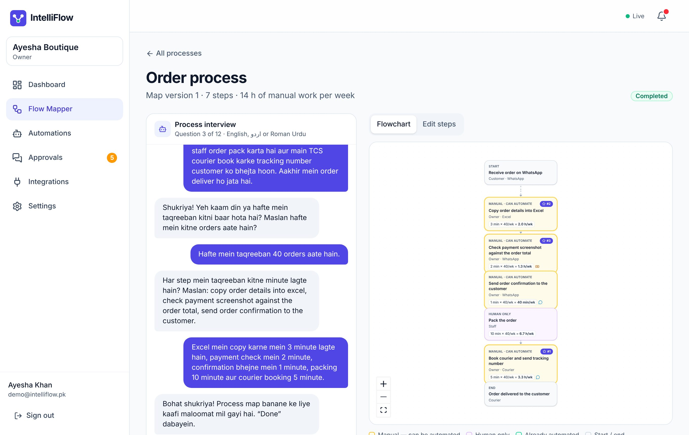
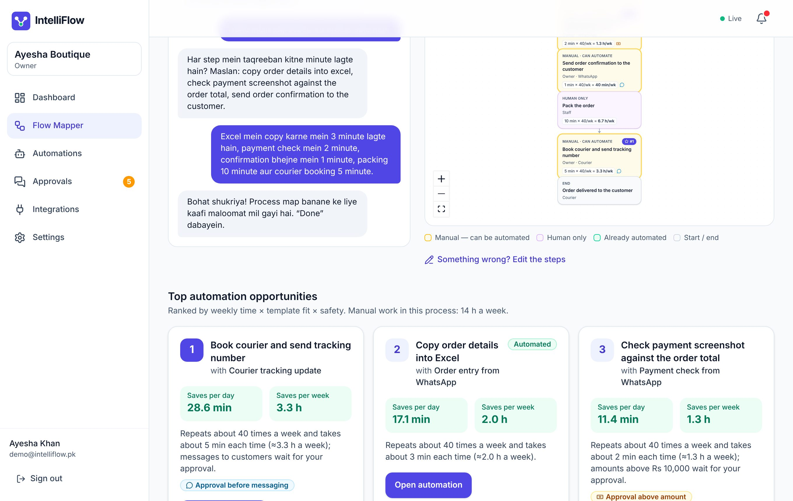
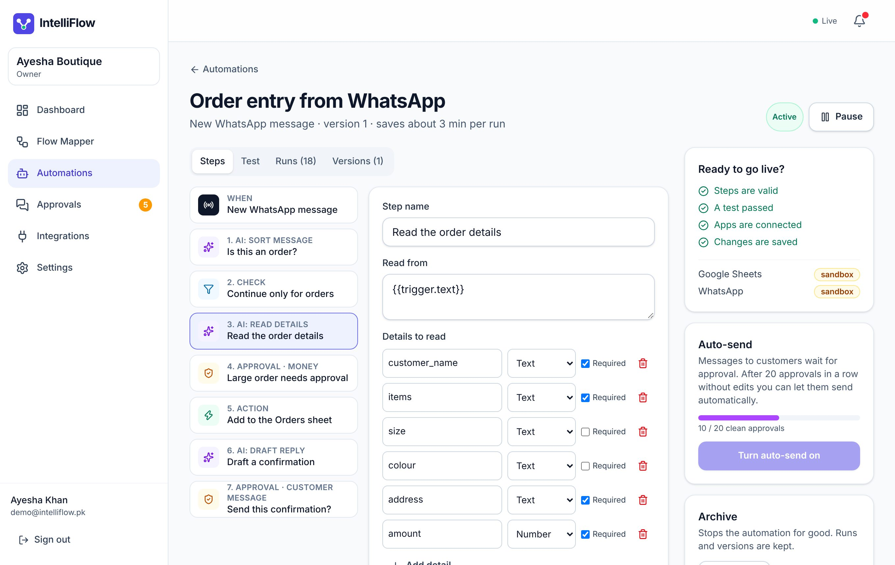
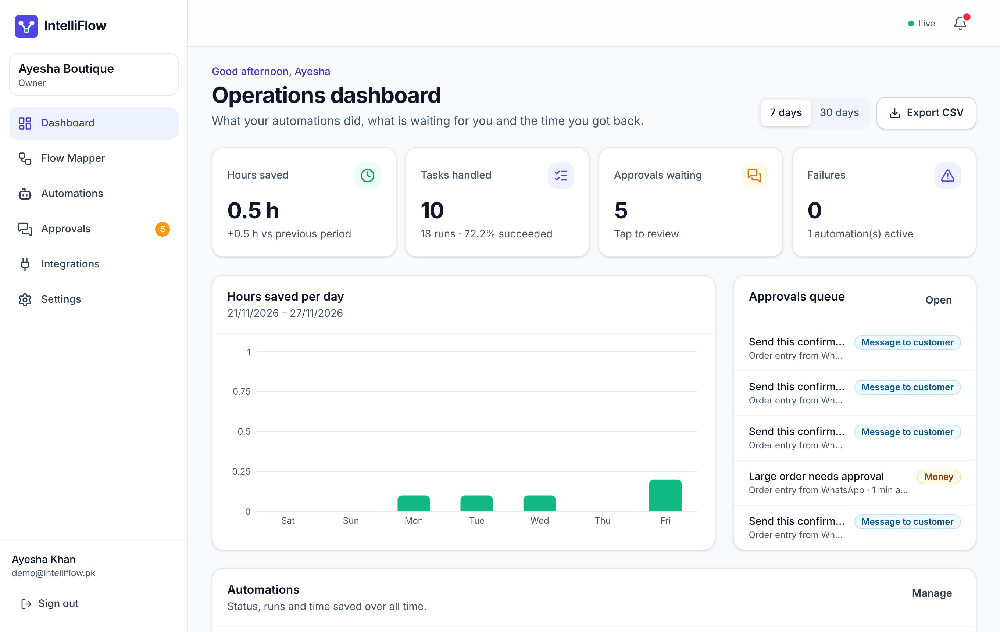
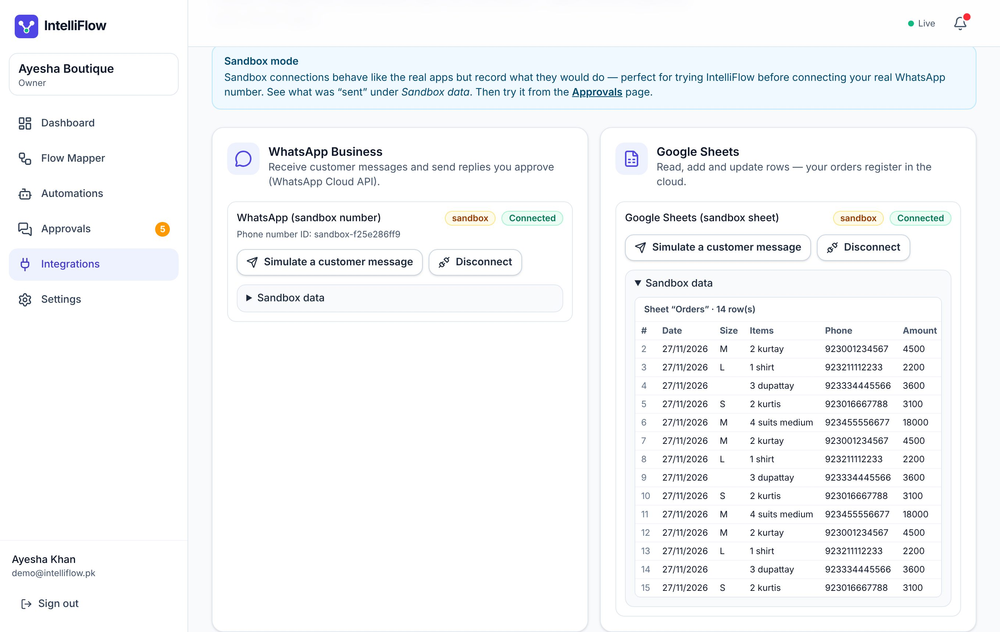
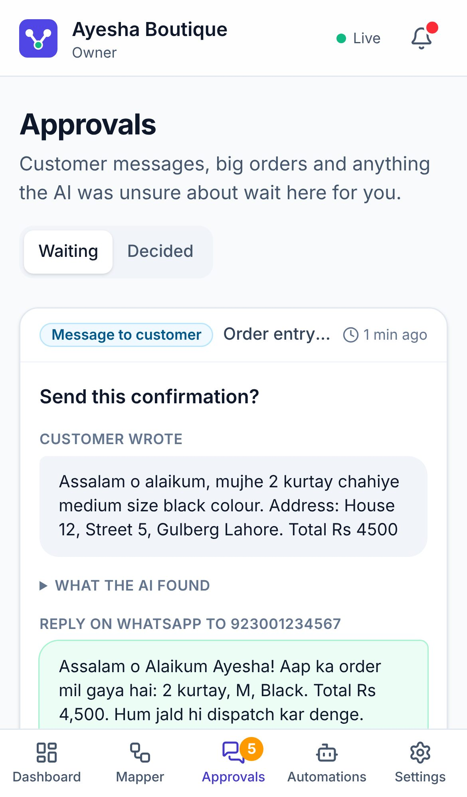
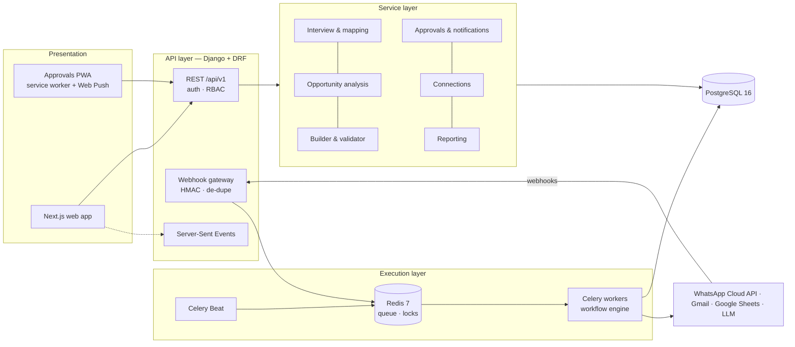

# IntelliFlow

**AI-powered workflow discovery and automation for small and medium enterprises.**
The owner tells IntelliFlow how the business runs — in English, Urdu or Roman Urdu — and IntelliFlow
draws the process, shows what to automate first, and then automates it safely, with a person
approving anything risky.

> Final Year Project prototype · FYP-BSCSM-F26-099 · Department of Computer Science, The Superior University, Lahore.
> Built to the design in the project report (Chapters 1–5): same stack, data model, algorithms and business rules.

| Flow Mapper: interview → process map | Ranked automation opportunities |
| --- | --- |
|  |  |
| **Automation Builder** | **Operations dashboard** |
|  |  |
| **Integrations (sandbox Orders sheet)** | **Approvals PWA on a phone** |
|  |  |

---

## What this prototype covers

This is a working prototype of roughly half of the system specified in the report: the FYP-I milestone
(Flow Mapper, release v0.1) plus most of the FYP-II core platform, runnable end to end. Every external
app works in **sandbox mode**, which behaves like the real app but records what it would do, so the whole
journey — interview, map, opportunity, automation, test, activation, a real signed webhook, approval,
dashboard — runs on a laptop with no API keys and no cost.

| Feature (Section 2.4) | Status | Notes |
| --- | --- | --- |
| **AC** Accounts & workspaces | ✅ | Register + e-mail verification, Argon2id, lockout after 5 failures for 15 min, 30-min reset links, Owner/Staff roles, invitations. *AC-7 Google sign-in: not yet.* |
| **FM** Interview & flow mapping | ✅ | Chat interview in English/Urdu/Roman Urdu, ≤ 12 questions, schema-validated map with ≤ 2 regenerations, editable flowchart, immutable versions, transcript. *FM-3 voice: browser speech recognition; WhatsApp voice-note transcription is FYP-II.* |
| **OA** Opportunity analysis | ✅ | Algorithm 5.2 exactly, template matching, top 3 with time saved per day/week and a one-line reason, dismiss → re-rank, "not yet supported" steps. |
| **IN** Integrations | 🟡 | Sandbox for WhatsApp, Gmail, Google Sheets and web forms; signed per-form webhook URLs (JSON + form data); tokens AES-256-GCM encrypted; refresh → "needs attention"; disconnect pauses dependants. Live WhatsApp Cloud API (manual connect / Meta test number) and Google OAuth + Sheets/Gmail clients are implemented but **not exercised against real accounts** in this build. *Meta Embedded Signup: FYP-II.* |
| **AB** AI automation builder | ✅ | Algorithm 5.3: template + LLM fill, JSON-schema + business-rule validation, ≤ 2 automatic repairs, plain-language errors, per-step editor, sandbox test run showing every step's input/output, activation gate, versions + rollback, create from template. |
| **WE** Workflow engine | ✅ | Algorithm 5.5 on Celery + Redis: blocks via Strategy pattern, retries 10 s/60 s/5 min, idempotent runs, masked step logs, encrypted run context, auto-pause after 5 failures, WhatsApp 24-hour window with template fallback, minutes saved. Gmail trigger by polling. |
| **AP** Human-in-the-loop approvals | ✅ | Approve / edit / reject (only whitelisted fields editable), immutable decisions, reminder at 2 h, expiry at 24 h, in-app + e-mail + Web Push, installable PWA usable at 360 px. |
| **DR** Dashboard & reports | 🟡 | KPIs, hours saved per day, automations table, run drill-down, live updates over SSE, CSV export. *PDF export: FYP-II.* |
| **PA** Platform administration | 🟡 | Usage, failure rate and LLM cost, AI credit limits (80% warning, pause at 100%), suspend/reactivate, template versioning and publishing, audit log. *Visual template editor: FYP-II (API only).* |

**Safety & security requirements** — SAF-1 customer messages always need approval (auto-send unlocks after 20
clean approvals) · SAF-2 kill switch · SAF-3 no delete operations exist · SAF-4 100 messages/hour/automation ·
SAF-5 test runs are sandboxed · SAF-6 uncertain extraction goes to a person · SEC-1 Argon2id · SEC-2 AES-256-GCM
with key rotation and row-bound associated data · SEC-4 RBAC + every query scoped by workspace · SEC-5 HMAC-SHA256
webhook verification · SEC-7 validated input, parameterised queries, rate-limited sign-in, CSP · SEC-8 personal
data masked in logs, 30-day purge · SEC-9 customer text is data, never code (no `eval`; whitelist expression interpreter).

## The algorithms in code (Section 5.1)

| Algorithm | Where |
| --- | --- |
| 5.1 Process interview & map generation | [`interview_agent.py`](backend/intelliflow/flowmapper/interview_agent.py), [`process_mapper.py`](backend/intelliflow/flowmapper/process_mapper.py) |
| 5.2 Opportunity scoring & ranking | [`analyzer.py`](backend/intelliflow/opportunities/analyzer.py) — `score = weekly_minutes × fit × (1 − 0.5 × min(risk, 1))` |
| 5.3 Automation generation with validation & repair | [`builder.py`](backend/intelliflow/automations/builder.py), [`validator.py`](backend/intelliflow/automations/validator.py) |
| 5.4 Webhook handling | [`gateway.py`](backend/intelliflow/integrations/gateway.py) |
| 5.5 Workflow execution with retries & approvals | [`workflow_engine.py`](backend/intelliflow/engine/workflow_engine.py), [`blocks/`](backend/intelliflow/engine/blocks) |

Process maps and workflows are validated against [`process_map.schema.json`](backend/intelliflow/jsonschemas/process_map.schema.json)
and [`workflow.schema.json`](backend/intelliflow/jsonschemas/workflow.schema.json); the shared template library (including
Listing 5.1, *Order entry from WhatsApp*) is in [`seeds.py`](backend/intelliflow/automations/seeds.py).

## Architecture (Section 4.1)



The LLM sits behind a provider-agnostic `LLMClient` ([`intelliflow/llm`](backend/intelliflow/llm)). Two implementations ship:
`AnthropicLLMClient` (Claude via the official SDK, structured outputs constrained to the JSON schema) and
`FakeLLMClient`, a deterministic offline stand-in that understands the English and Roman Urdu demo
scenarios, so tests and demos are repeatable and free.

## Stack (Table 5.1)

| Layer | Technology |
| --- | --- |
| Frontend | Next.js 16 (App Router), React 19, TypeScript (strict), Tailwind CSS 4, React Flow, TanStack Query, Zod, Recharts, Workbox service worker + Web Push |
| Backend | Python 3.12, Django 5.2, Django REST Framework, Gunicorn, Django ORM + migrations, drf-spectacular, djangorestframework-simplejwt, Django Argon2 hasher, PostgreSQL 16, Celery + Redis 7, jsonschema, httpx, google-auth + Google API client, cryptography, pywebpush, Anthropic SDK |
| Platform Admin | Django admin site (`/admin/`): templates, metrics, AI credit limits, workspace suspension, audit log |
| Quality | pytest, Playwright, Locust, Ruff, Black, mypy, ESLint, Prettier, GitHub Actions |

## Run it

### Option A — Docker Compose

Needs Docker with Compose 2.24 or newer (`docker compose version`).

```bash
docker compose up --build
```

The first build downloads and compiles everything and takes several minutes. Keep that terminal open:
the app runs for as long as the command does, and <kbd>Ctrl</kbd>+<kbd>C</kbd> stops it. When the log prints
`IntelliFlow is ready`, open <http://localhost:3000> and sign in with **demo@intelliflow.pk / Demo12345**.
The first start loads that demo workspace automatically (`SEED_DEMO=false docker compose up --build` starts
empty). To run in the background instead, use `docker compose up --build -d` and stop it with
`docker compose down`.

Copying `.env.example` to `.env` is optional; do it to switch on the real services listed below.

#### If it does not start

```bash
docker compose ps -a
```

Every service except `migrate` should show `Up`, and `migrate` should show `Exited (0)`. If something else
appears, the reason is in its log, for example:

```bash
docker compose logs migrate api
```

| Message | Fix |
| --- | --- |
| `service "api" is not running` | The stack is not up: it is still building, it was stopped with Ctrl+C, or a service failed (see `docker compose ps -a`). Start it with `docker compose up --build`. |
| `port is already allocated` / `address already in use` for 3000 or 8000 | Another program uses the port. Pick free ones: `WEB_PORT=3100 API_PORT=8100 docker compose up --build`, then open <http://localhost:3100>. |
| `permission denied ... docker.sock` | Your user is not in the `docker` group: run `sudo usermod -aG docker $USER`, log out and back in. |
| An error about `env_file` before anything starts | Compose is older than 2.24: update Docker. |

PostgreSQL and Redis run inside the Compose network only, so copies already installed on your machine do not
clash with them. `docker compose down -v` deletes the database too, for a completely fresh start.

### Option B — locally

Requires Python 3.12+, Node 20.9+, PostgreSQL 16 and Redis 7 (both optional for a quick look: without
`DATABASE_URL` the API uses SQLite, and without Redis it falls back to an in-memory store).

```bash
cd backend
python3 -m venv .venv && .venv/bin/pip install -e ".[dev]"
.venv/bin/python manage.py migrate
.venv/bin/python manage.py seed
.venv/bin/python manage.py runserver
```

```bash
cd backend && .venv/bin/celery -A config worker -Q intelliflow --loglevel=INFO
```

```bash
cd backend && .venv/bin/celery -A config beat --loglevel=INFO
```

```bash
cd frontend && npm install && npm run dev
```

(Set `CELERY_TASK_ALWAYS_EAGER=true` to run tasks inside the API process instead of a worker.)

### Demo data and accounts

Docker Compose loads the demo on first start. Locally, run:

```bash
cd backend && .venv/bin/python manage.py demo
```

This creates **demo@intelliflow.pk / Demo12345** with the *Ayesha Boutique* workspace: a Roman Urdu order-process
interview, its map and opportunities, an active *Order entry from WhatsApp* automation and a week of runs,
some waiting for approval. In development, verification e-mails are kept in an outbox — the sign-up page
shows the link directly. A platform admin can be created with
`python manage.py create_admin --email … --password …`; platform admins sign in at <http://localhost:8000/admin/>.

### Try the journey yourself

1. Register, then create a workspace.
2. **Flow Mapper** → *Order process* → answer in Roman Urdu or English → **Done — draw my map**.
3. **Integrations** → *Use sandbox* for WhatsApp and Google Sheets.
4. Back on the map → **Automate this** on *Copy order details into Excel* → **Test** → **Activate**.
5. **Integrations → WhatsApp → Simulate a customer message** — it goes through the real signed-webhook
   gateway and the worker, or use `python scripts/webhook_simulator.py --phone-number-id <id> --sample-orders`.
6. **Approvals** (best on a phone) → approve or edit the drafted Roman Urdu reply. Watch the dashboard update live.

### Real services

| Setting | Effect |
| --- | --- |
| `LLM_PROVIDER=anthropic`, `ANTHROPIC_API_KEY` | Use Claude (default model `claude-opus-5-5`, change with `LLM_MODEL`). |
| `WHATSAPP_APP_SECRET`, `WHATSAPP_VERIFY_TOKEN` | Meta webhook signature and subscription handshake (`/api/v1/webhooks/whatsapp`). |
| `GOOGLE_CLIENT_ID`, `GOOGLE_CLIENT_SECRET` | Google OAuth for Gmail and Sheets (redirect URI `<API_PUBLIC_URL>/api/v1/oauth/google/callback`). |
| `VAPID_PUBLIC_KEY`, `VAPID_PRIVATE_KEY` | Web Push for approvals (`python manage.py generate_vapid`). |
| `EMAIL_BACKEND=smtp`, `SMTP_*` | Send real e-mails instead of the development outbox. |
| `SECRET_KEY`, `ENCRYPTION_KEYS` | Required outside development (`python manage.py generate_keys`); the API refuses to start with the dev defaults. |

API documentation (OpenAPI) is served at <http://localhost:8000/api/docs>.

## Tests and measured results

| Suite | Command | Result in this build |
| --- | --- | --- |
| Backend unit + API tests | `cd backend && .venv/bin/python -m pytest --cov` | 79 tests pass on SQLite and on PostgreSQL 16 (`TEST_DATABASE_URL=…`); 83% coverage (gate: 70%) |
| Static checks | `ruff check app tests && black --check app tests && mypy app` · `npm run lint && npm run typecheck` | clean |
| Migrations | `manage.py migrate && manage.py makemigrations --check` | applies cleanly, no model drift |
| End to end | `cd frontend && npm run test:e2e` (API on :8000, web on :3000) | owner journey (desktop) and approvals PWA (360 px phone) pass against a real Celery worker |
| Load | `locust -f loadtests/locustfile.py --host http://localhost:8000 --users 50 --headless --run-time 2m` | 50 users, 1,150 requests, 0 failures; p95: dashboard 220 ms, automations 190 ms, approvals 740 ms, runs 1.2 s (PERF-1: < 2 s); webhook acknowledgement p95 **61 ms** (PERF-2 target: < 1 s) — single VM shared by API, worker, database and web |

## Project structure

```
backend/
  config/            Django settings (from environment variables), URLs, WSGI, Celery + Beat
  intelliflow/       one Django app per module of the report, each with models, services,
                     serializers, views (DRF viewsets), urls, admin and Celery tasks:
    accounts/        AC: users, sign-in, JWT (simplejwt), password reset
    workspaces/      AC: workspaces, members, invitations, kill switch
    flowmapper/      FM: interview agent, process mapper (Algorithm 5.1)
    opportunities/   OA: scoring and ranking (Algorithm 5.2)
    automations/     AB: builder, validator and repair (Algorithm 5.3), template library
    integrations/    IN: connectors (Adapter pattern), webhook gateway (Algorithm 5.4)
    runs/            WE: runs, event router, scheduler, Celery tasks
    approvals/       AP: approval queue and decisions
    notifications/   in-app, Web Push, e-mail outbox, live-update event bus (SSE)
    audit/           audit log and LLM usage
    dashboard/       DR: dashboard figures and CSV report
    platform_admin/  PA: Django admin site (metrics, suspension, limits, templates)
    engine/          workflow engine, safe expressions, block library (Strategy pattern)
    llm/             LLMClient, Claude adapter, FakeLLMClient, prompts, output schemas
    core/            errors, crypto, masking, permissions, middleware, management commands
  tests/             unit and API tests
  scripts/           webhook simulator
frontend/
  src/app/           pages: auth, onboarding, dashboard, flow mapper, automations, approvals,
                     runs, integrations, settings, admin
  src/components/    UI kit, process map, chat, builder, approval card, charts
  src/lib/           API client, query hooks, session, SSE, push, Zod schemas
  sw/                Workbox service worker source
  e2e/               Playwright tests
loadtests/           Locust scenarios
docs/screenshots/
```

## Known limitations (next steps for FYP-II)

- Live WhatsApp, Gmail and Google Sheets calls are implemented but were only exercised in sandbox mode here;
  Meta Embedded Signup and Tech Provider onboarding are not built yet (manual connect with the Meta test number works).
- WhatsApp voice notes and payment screenshots are not transcribed/read yet; the interview accepts voice through the browser's speech recognition.
- The offline `FakeLLMClient` is tuned for the demo scenarios (English and Roman Urdu); Urdu-script answers need the real LLM.
- Not yet built: Google sign-in (REQ-AC-7), PDF reports (REQ-DR-5), a visual template editor for admins, staging/production deployment configs (Vercel, Render/Railway).
- The pilot with a real SME and the ≥ 90% extraction-accuracy evaluation (Objective 7) are FYP-II work.

## Conventions

Conventional Commits, `main` / `develop` / `feature/*` branches, PEP 8 via Ruff + Black, mypy, strict TypeScript with
ESLint + Prettier, schema changes only through Alembic, every query scoped by `workspace_id` (Section 5.5–5.6).
